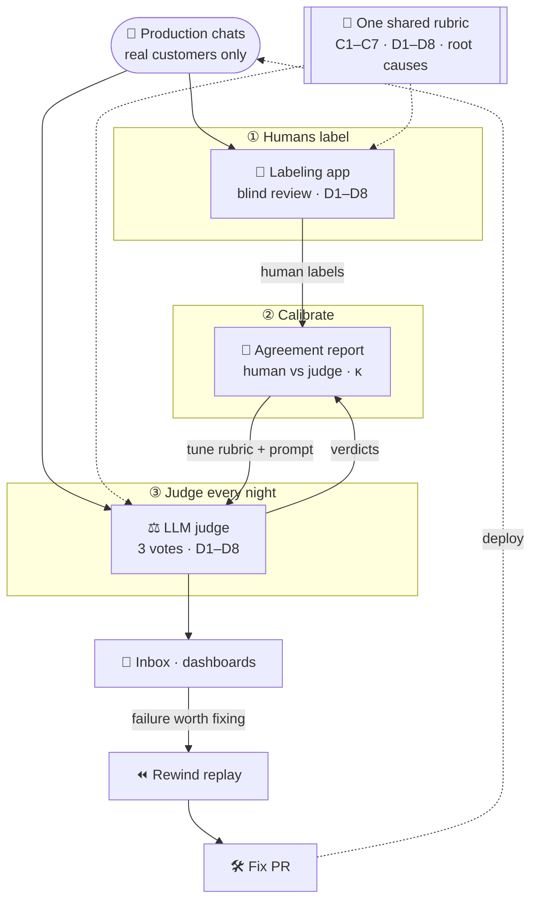
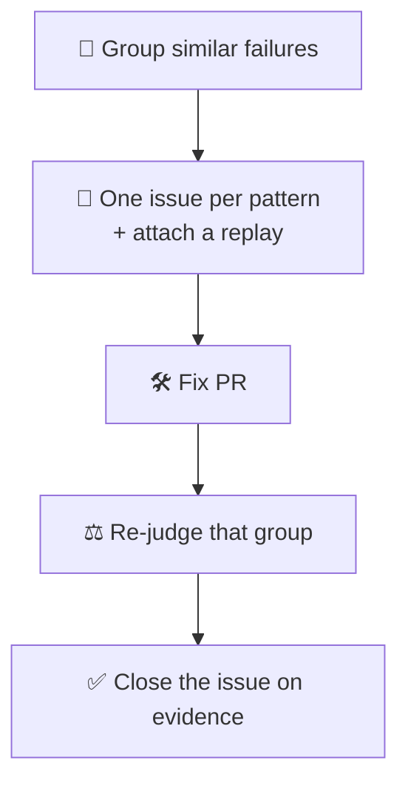

At Funnel, we rely on our Funnel AI assistant to analyze customers' data and answer marketing-data questions. In order to understand whether the responses are helpful or not, someone must read real conversations. However, it is impossible for a human to evaluate approximately 200 conversations per day which involve a lot of complex numeric data. Therefore, I have built an end-to-end eval system that can read and grade all the conversations every night.

An automated judge is only useful if we can trust it. As a result we did not immediately start with the judge. Instead, we started with human labels:

1. **Human labeling**: reviewers grade real conversations by hand.
2. **Judge calibration**: we compare the LLM judge against those human labels until they agree.
3. **Automated nightly judge**: once the judge is calibrated, it grades every conversation, every night.

This post explains the system I built and what I learned along the way.

## The system at a glance



Humans and the judge read the same rubric. The agreement report connects them. Moreover, the loop never stops: reviewers keep labeling, so the calibration keeps running after the judge goes live.

## 1. One rubric, shared by everyone

Every conversation gets **one category** and **eight pass/fail checks**.

| Code | Check | In one line |
|---|---|---|
| D1 | Task Resolution | Did it do what the user asked, or say why not? |
| D2 | Accuracy & Grounding | Every number comes from tool output. |
| D3 | Context & Scope | Right account, period and question. |
| D4 | Tool Use | Right tools, sensible order, no waste. |
| D5 | Communication | Clear and as short as possible. |
| D6 | Language | The user's language and locale. |
| D7 | Boundaries | Says "I can't" and escalates when it should. |
| D8 | Robustness | No errors, loops or broken output. |

The verdict rule is simple: **FAIL if D1 fails, or if any failure is a Blocker or Major.**

Each failure also gets a **root cause**. The root cause tells us who fixes it:

- `agent_behaviour` → we update the agent
- `product_capability_gap` → it goes on the product roadmap
- `content` → we fix the docs
- `infrastructure_bug` → engineering

## 2. Humans first: the labeling app

Having a ground truth for evaluating an AI agent is very important to build a trustworthy evaluation system. In order to get that ground truth, we built a labeling app where reviewers grade conversations by hand. It is a hosted web app, so all reviewers work on one shared corpus.

A review has four steps:

```
Pick → Read → Mark → Compare
```

1. **Pick**: filter the inbox, for example "unlabeled US conversations that used `verify_numbers`".
2. **Read**: see the full transcript, including tool calls, tool results and charts.
3. **Mark**: give a verdict and mark D1–D8.
4. **Compare**: only now, reveal the judge's verdict.

The most important design choice is in step 4. **The judge's verdict is hidden until the reviewer saves their label.** If the reviewer sees the judge first, they tend to agree with it. Then we measure how often humans copy the judge, not how often they agree with it.

When the reviewer reveals the verdict, they see more than pass or fail. For example, a badge shows `2–1 split` if the three judge votes disagreed. A collapsed block shows the minority vote and its reasoning. This is where we find the conversations that are hard to grade, and also the rubric definitions that are unclear.

Moreover, the conversations contain customer data. Therefore, the app is hosted in the EU, and only reviewers on an allowlist can open it.

## 3. Calibrating the judge

With human labels in place, we can ask: does the judge agree with the reviewers?

Firstly, both sides must read **the same definition text** for every check. Before, the judge saw only the title, for example "D4: Tool Use". The reviewer saw a full definition. So they disagreed, but the cause was the wording and not the conversation. Now both read one shared definition. If someone changes it, CI fails until they bump a version, and every verdict records which version it used.

Secondly, we measure agreement with Cohen's κ (kappa). κ is agreement after you remove agreement by luck.

> Example: two reviewers who each say "pass" 80% of the time agree 68% of the time by pure luck. If they really agree 84%, κ = (84 − 68) ÷ (100 − 68) = **0.5**.

We measured this on 39 human-labeled US conversations. With the old D2 (grounding) definition, the judge reached κ = **0.24**. When I rewrote the D2 definition to be stricter, κ went to **0.41**, and the false passes went from 13 to 10. That is better, but still only "moderate".

Two rules keep the comparison honest:

- A judge that fails good work wastes reviewers' time. A judge that passes bad work hides real failures. Therefore, the report counts false passes and false fails separately, and it never shows a single "accuracy" percentage.
- Every label records the version of the conversation it graded. If the human and the judge graded different versions, the pair is excluded and not scored.

## 4. Automating: the nightly judge

Once the judge agrees with humans well enough, it can grade at a scale that humans cannot. Every night, the LLM-as-judge evaluator starts its evaluation:

```
Discover → Export → Artifact gate → Judge ×3 → Vote → Write + alarm
```

1. **Discover**: find yesterday's chats from external users.
2. **Export**: load the transcript, charts and files.
3. **Artifact gate**: check that the judge can see *everything*.
4. **Judge ×3**: an LLM grades the same conversation three times.
5. **Vote**: the majority wins.
6. **Write**: store the verdict. If something goes wrong, alarm.

Three details mattered more than I expected.

**Voting.** With the same prompt and the same conversation, the judge gave different verdicts in **13%** of conversations. Therefore, each conversation is now judged three times, and the majority wins.

**Fair sampling.** The first version picked the newest chats first. As a result, 84% of the sample came from after 16:00 UTC, but only 37% of traffic starts then. The sample graded the US afternoon, not the product. Now the pick is spread across region × hour.

**Fail closed.** In order to give a fair judgement, the judge must see the same context that Funnel AI saw. Therefore, an artifact gate holds back any conversation the judge cannot fully see. If the whole run is blind, it is skipped.

## 5. From a failure to a fix

The last piece of the system is **Rewind**, a small library that replays a real conversation locally.

You take a production conversation and fork it at a checkpoint. Then you change one thing and assert on what the agent does:

```ts
const fork = session.atCheckpoint("after-tool-error")
  .replaceToolResult("create-skill-1", { error: true, error_type: "permission_error" });

const result = await fork.runModelTurn(model);

evaluateReplay(result, [
  { type: "tool_not_called", name: "create_skill" },               // no blind retry
  { type: "text_contains_any", values: ["permission", "admin"] },  // tells the user why
]);
```

Here is an example case that shows why local validation matters:

1. **The judge flags D2.** The agent gave a confident "top 3 campaigns" ranking. However, it had read the ranking off an approximate chart.
2. **Replay it.** I turned that conversation into a local fixture. The failure reproduced.
3. **Smallest fix.** Before the agent states a ranking, it re-runs the exact query and binds the rows to its answer.
4. **Replay passes.** 3 out of 3 runs gave a grounded ranking.
5. **In production.** The new check fired 29 times in 19 conversations in the first snapshot.

## Learnings along the way

- **Start with humans:** Without human labels, you have no way to know if the judge is right.
- **Hide the judge from reviewers:** If reviewers see the verdict first, you measure copying, not agreement.
- **Keep evaluators aligned:** If human labelers and the judge read different definitions, you measure the wording, not the agent.
- **Version the ruler:** When the rubric or the judge model changes, old and new numbers are not comparable. Compare like with like.
- **Vote:** One LLM call is a noisy sample: in October, the three votes split 2–1 on 13% of conversations. Three votes cost three judge calls per conversation, and the majority decides each split.
- **Surface failures:** Most of the worst bugs were silent: a blind judge, a biased sample, an empty run that looked like success.
- **Close the loop:** A grade is only useful if it becomes a replay, a fix and a re-check.

## What's next

For now we only get *grading* from the judge. My next focus will be finding a good way of *acting* on nightly findings:


